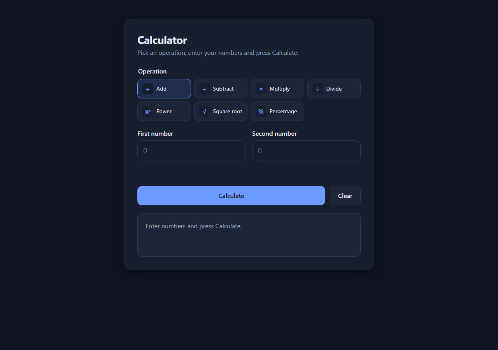
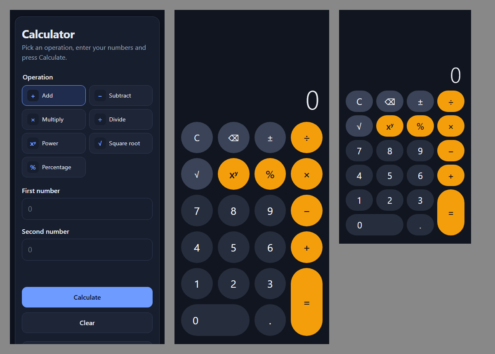
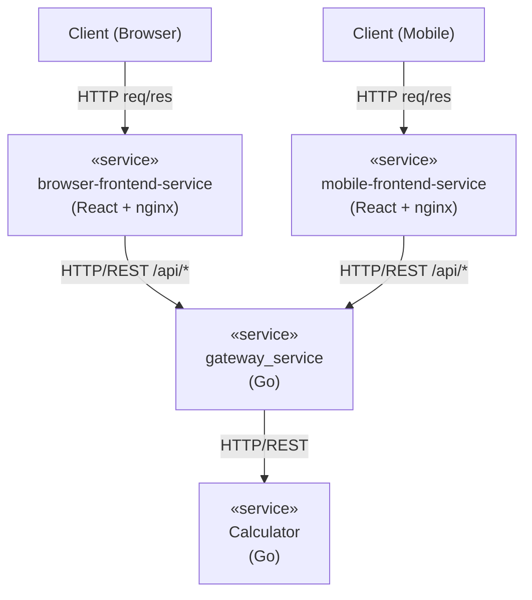
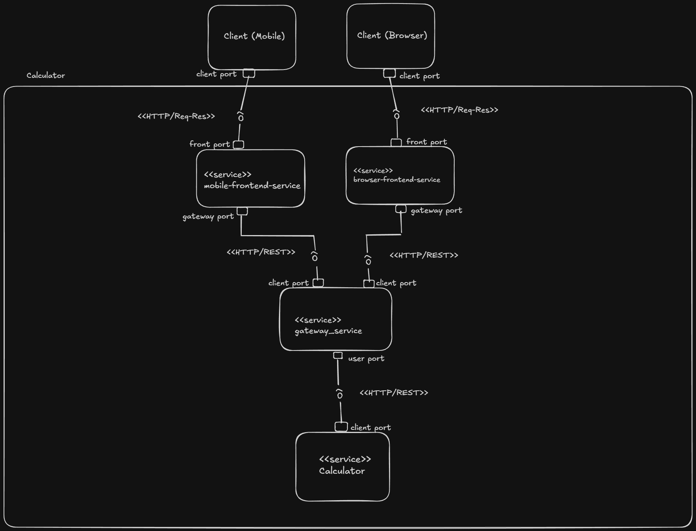
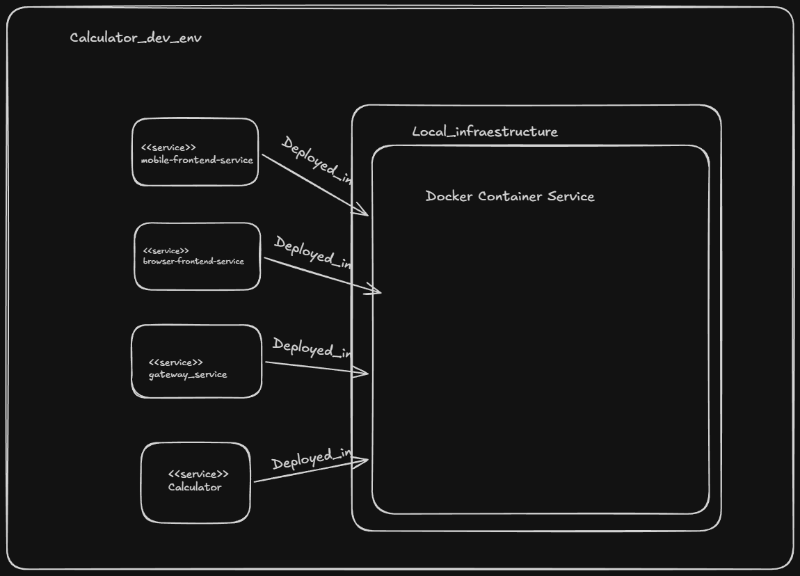

# Calculator — React + Go microservices

A full-stack calculator. Two React/TypeScript frontends, one for desktop browsers and one for mobile, call a Go **API gateway**, which forwards requests to a Go **calculator service** that does the arithmetic.

Supported operations: **add, subtract, multiply, divide** (required) and **power, square root, percentage** (optional).

| Browser frontend (desktop) | Mobile frontend + responsive browser frontend (375 px / 320 px) |
| --- | --- |
|  |  |

---

## Contents

1. [Architecture](#architecture)
2. [Repository layout](#repository-layout)
3. [Prerequisites](#prerequisites)
4. [Quick start (Docker)](#quick-start-docker)
5. [Running locally without Docker](#running-locally-without-docker)
6. [REST API](#rest-api)
7. [Tests and coverage](#tests-and-coverage)
8. [Design decisions](#design-decisions)
9. [Assumptions](#assumptions)
10. [AI assistance](#ai-assistance)

---

## Architecture

The code follows the component-and-connector (C&C) and deployment views in [`Diagram_calculator/Excalidraw/`](Diagram_calculator/Excalidraw/). Open them in Obsidian with the Excalidraw plugin.



| Service | Tech | Responsibility | Port (Docker / local dev) |
| --- | --- | --- | --- |
| `browser-frontend` | React 19, TypeScript, Vite → nginx | Form-based UI for desktop browsers, responsive down to phones. Serves the SPA and proxies `/api/` to the gateway. | `3000` / `5173` |
| `mobile-frontend` | React 19, TypeScript, Vite → nginx | Touch keypad UI for phones. Serves the SPA and proxies `/api/` to the gateway. | `3001` / `5174` |
| `gateway` | Go (stdlib `httputil.ReverseProxy`) | Single entry point: routing, request IDs, access logs, body-size limit, upstream timeout, uniform 502/504 errors, optional CORS. | `8090` |
| `calculator` | Go (stdlib) | Validates input and performs the arithmetic. Not exposed to the host in Docker. | internal `8091` |

**Components and conectors view:**



**Deployment view:** `docker-compose.yml` runs all four services as containers on the local infrastructure. Two Docker networks enforce the C&C connectors:



- `frontend` holds the two frontends and the gateway.
- `backend` holds the gateway and the calculator.

So a frontend cannot reach the calculator directly.


A request ID (`X-Request-ID`) is created at the gateway (or accepted from the client), passed to the calculator, written in both services' JSON logs and returned in the response `metadata`. One calculation can therefore be traced across services.

## Repository layout

```
.
├── backend/                       Go module (one module, two services)
│   ├── cmd/
│   │   ├── calculator/main.go     calculator service entry point
│   │   └── gateway/main.go        gateway service entry point
│   ├── internal/
│   │   ├── calculator/            pure domain logic (operations, domain errors)
│   │   ├── calculatorapi/         HTTP handler: routing, validation, error mapping
│   │   ├── gateway/               reverse proxy + upstream error translation
│   │   ├── api/                   shared JSON envelope + error codes
│   │   ├── middleware/            request ID, access log, panic recovery, CORS
│   │   └── server/                env config, timeouts, graceful shutdown
│   └── Dockerfile                 builds either service (--build-arg SERVICE=…)
├── frontend/
│   ├── browser/                   browser-frontend-service (Vite + React + TS)
│   └── mobile/                    mobile-frontend-service  (Vite + React + TS)
├── Diagram_calculator/            C&C and deployment diagrams (Excalidraw)
├── docs/screenshots/
├── prompts/                       AI prompts used during development
└── docker-compose.yml
```

## Prerequisites

| Tool | Version | Needed for |
| --- | --- | --- |
| Go | **1.24+** (developed with 1.27) | backend |
| Node.js | **20.19+ or 22.12+** (24 LTS recommended; developed with 20.19) | frontends |
| npm | 10+ | frontends |
| Docker + Docker Compose v2 | any recent | optional, runs everything at once |

The backend has **no third-party dependencies**; it uses only the Go standard library.

## Quick start (Docker)

```bash
docker compose up --build
```

| Open | URL |
| --- | --- |
| Browser frontend | http://localhost:3000 |
| Mobile frontend | http://localhost:3001. On a phone on the same Wi-Fi, use `http://<your-PC-IP>:3001` |
| Gateway (for curl) | http://localhost:8090 |

Stop with `Ctrl+C`, then `docker compose down`.

## Running locally without Docker

Use four terminals, one per service. Start them in this order: calculator, then gateway, then the frontends.

**1. Calculator service** (listens on `:8091`)

```bash
cd backend
go run ./cmd/calculator
```

**2. Gateway** (listens on `:8090` and forwards to `http://localhost:8091`)

```bash
cd backend
go run ./cmd/gateway
```

Both services are configured with environment variables. The defaults work as-is for local development.

| Service | Variable | Default | Description |
| --- | --- | --- | --- |
| calculator | `PORT` | `8091` | listen port |
| gateway | `PORT` | `8090` | listen port |
| gateway | `CALCULATOR_URL` | `http://localhost:8091` | calculator base URL |
| gateway | `UPSTREAM_TIMEOUT` | `5s` | max wait for the calculator (Go duration) |
| gateway | `ALLOWED_ORIGINS` | *(empty)* | comma-separated origins allowed to call the gateway directly from a browser |

Set them in bash with `PORT=9000 go run ./cmd/gateway`, or in PowerShell with `$env:PORT="9000"; go run ./cmd/gateway`.

**3. Browser frontend** (http://localhost:5173)

```bash
cd frontend/browser
npm install
npm run dev
```

**4. Mobile frontend** (http://localhost:5174)

```bash
cd frontend/mobile
npm install
npm run dev
```

The Vite dev server proxies `/api` to the gateway, just as nginx does in Docker. To use a gateway on another address, set `GATEWAY_URL`, for example `GATEWAY_URL=http://localhost:9000 npm run dev`. To try the mobile UI on a real phone during development, run `npm run dev -- --host` and open the printed network URL.

Other useful scripts, available in both frontends:

| Script | What it does |
| --- | --- |
| `npm run build` | type-check (`tsc -b`) and build a production bundle into `dist/` |
| `npm run lint` | ESLint (typescript-eslint, react-hooks, react-refresh) |
| `npm test` | run the unit and integration tests once |
| `npm run coverage` | tests plus a coverage report (`coverage/index.html`) |

## REST API

The gateway exposes the API. The calculator serves the same routes, but in Docker it is only reachable through the gateway.

### Design: one endpoint per operation

```
POST /api/v1/{operation}
Content-Type: application/json

{"a": <number>, "b": <number>}      // "b" is omitted for sqrt
```

`{operation}` is one of: `add`, `subtract`, `multiply`, `divide`, `power`, `sqrt`, `percentage`.

| Operation | Meaning | Example body | Result |
| --- | --- | --- | --- |
| `add` | a + b | `{"a": 2, "b": 3}` | `5` |
| `subtract` | a − b | `{"a": 2, "b": 3}` | `-1` |
| `multiply` | a × b | `{"a": 6, "b": 7}` | `42` |
| `divide` | a ÷ b | `{"a": 10, "b": 4}` | `2.5` |
| `power` | a ^ b | `{"a": 2, "b": 10}` | `1024` |
| `sqrt` | √a | `{"a": 81}` | `9` |
| `percentage` | a % of b | `{"a": 20, "b": 50}` | `10` |

Health checks: `GET /healthz` on each service returns `{"status":"ok"}`.

### Response envelope

Every response, success or error, has the same shape, and exactly one of `result` or `error` is `null`:

```json
{
  "operation": "divide",
  "operands": { "a": 10, "b": 4 },
  "result": 2.5,
  "error": null,
  "metadata": { "requestId": "39b35a76c5e01c72", "timestamp": "2026-10-02T12:54:11.0089145Z" }
}
```

```json
{
  "operation": "divide",
  "result": null,
  "error": { "code": "DIVISION_BY_ZERO", "message": "division by zero is undefined" },
  "metadata": { "requestId": "199b45d866123c60", "timestamp": "2026-10-02T12:54:11.0469793Z" }
}
```

Clients should branch on `error.code`, which is a stable contract. `error.message` is human-readable and may change.

### Status codes and error codes

| HTTP | `error.code` | When |
| --- | --- | --- |
| 200 | — | success |
| 400 | `INVALID_JSON` | empty body, malformed JSON, not an object, trailing data, or unknown field |
| 400 | `INVALID_OPERAND` | operand is not a number (`"1"`, `true`) or is outside the float64 range (`1e400`) |
| 400 | `MISSING_OPERAND` | `a` missing or `null`, or `b` missing for a binary operation |
| 400 | `UNEXPECTED_OPERAND` | `b` sent to `sqrt` |
| 404 | `UNKNOWN_OPERATION` | e.g. `/api/v1/modulo`; the message lists the supported operations |
| 404 | `NOT_FOUND` | any other unknown route |
| 405 | `METHOD_NOT_ALLOWED` | anything other than `POST` on an operation (an `Allow: POST` header is set) |
| 413 | `PAYLOAD_TOO_LARGE` | body over 4 KiB |
| 415 | `UNSUPPORTED_MEDIA_TYPE` | `Content-Type` present but not `application/json` |
| 422 | `DIVISION_BY_ZERO` | `divide` by 0, or `power` with base 0 and a negative exponent |
| 422 | `NEGATIVE_SQUARE_ROOT` | `sqrt` of a negative number |
| 422 | `UNDEFINED_RESULT` | result is not a real number, e.g. `power` of −8 to the 0.5 |
| 422 | `RESULT_OUT_OF_RANGE` | result overflows float64, e.g. `multiply` 1e308 by 10 |
| 500 | `INTERNAL_ERROR` | unexpected panic (recovered) |
| 502 | `UPSTREAM_UNAVAILABLE` | gateway cannot reach the calculator |
| 504 | `UPSTREAM_TIMEOUT` | calculator did not answer within `UPSTREAM_TIMEOUT` |

### Example calls

These use bash/Git Bash `curl`. In Windows PowerShell, see the note after the examples.

```bash
# Success
curl -s -X POST http://localhost:8090/api/v1/divide \
  -H 'Content-Type: application/json' -d '{"a": 10, "b": 4}'
# {"operation":"divide","operands":{"a":10,"b":4},"result":2.5,"error":null,"metadata":{"requestId":"39b35a76c5e01c72","timestamp":"…"}}

# Unary operation
curl -s -X POST http://localhost:8090/api/v1/sqrt \
  -H 'Content-Type: application/json' -d '{"a": 2}'
# {"operation":"sqrt","operands":{"a":2},"result":1.4142135623730951,"error":null,"metadata":{…}}

# Percentage: 20 % of 50
curl -s -X POST http://localhost:8090/api/v1/percentage \
  -H 'Content-Type: application/json' -d '{"a": 20, "b": 50}'
# {"operation":"percentage","operands":{"a":20,"b":50},"result":10,"error":null,"metadata":{…}}

# Division by zero -> 422
curl -s -i -X POST http://localhost:8090/api/v1/divide \
  -H 'Content-Type: application/json' -d '{"a": 1, "b": 0}'
# HTTP/1.1 422 Unprocessable Entity
# X-Request-Id: 199b45d866123c60
# {"operation":"divide","result":null,"error":{"code":"DIVISION_BY_ZERO","message":"division by zero is undefined"},"metadata":{…}}

# Invalid type -> 400
curl -s -X POST http://localhost:8090/api/v1/add \
  -H 'Content-Type: application/json' -d '{"a": "x", "b": 0}'
# {"operation":"add","result":null,"error":{"code":"INVALID_OPERAND","message":"operand \"a\" must be a finite number, got string"},"metadata":{…}}

# Missing operand -> 400
curl -s -X POST http://localhost:8090/api/v1/subtract \
  -H 'Content-Type: application/json' -d '{"a": 5}'
# {"operation":"subtract","result":null,"error":{"code":"MISSING_OPERAND","message":"operand \"b\" is required for operation \"subtract\""},"metadata":{…}}

# Unknown operation -> 404
curl -s -X POST http://localhost:8090/api/v1/modulo \
  -H 'Content-Type: application/json' -d '{"a": 5, "b": 2}'
# {"result":null,"error":{"code":"UNKNOWN_OPERATION","message":"unknown operation \"modulo\"; supported operations: add, divide, multiply, percentage, power, sqrt, subtract"},"metadata":{…}}
```

**Windows PowerShell 5.1:** there, `curl` is an alias for `Invoke-WebRequest`. Use `Invoke-RestMethod` instead:

```powershell
Invoke-RestMethod -Method Post -Uri http://localhost:8090/api/v1/multiply `
  -ContentType 'application/json' -Body '{"a": 6, "b": 7}'
```

## Tests and coverage

### Run everything

```bash
# Backend: format check, vet, tests with coverage
cd backend
gofmt -l .            # prints nothing when the code is formatted
go vet ./...
go test ./... -cover

# Each frontend
cd frontend/browser   # then repeat in frontend/mobile
npm ci
npm run lint
npm run build         # includes tsc type-check
npm run coverage
```

### Coverage summary

Measured on 2026-10-02.

| Component | Tests | Statement coverage |
| --- | --- | --- |
| `backend/internal/calculator` | 32 | 100 % |
| `backend/internal/calculatorapi` | 36 | 100 % |
| `backend/internal/gateway` | 6 | 100 % |
| `backend/internal/api` | 4 | 100 % |
| `backend/internal/middleware` | 12 | 95.7 % |
| `backend/internal/server` | 3 | 91.7 % |
| `frontend/browser` | 63 | 97.6 % (branches 95.6 %) |
| `frontend/mobile` | 53 | 95.6 % (branches 94.8 %) |

Backend counts include table-driven subtests. The `cmd/*/main.go` files are thin wiring and are not unit-tested; they are covered by the end-to-end run described below.

### What the tests cover

**Backend (Go, `testing` plus `net/http/httptest`, no mocks library)**

- `calculator`: every operation, including negative numbers, fractions and zeros. Domain edge cases: division by ±0, 0 to a negative power, a negative base with a fractional exponent (NaN), overflow to ±Inf, the square root of a negative, and normalising −0. Also the operation registry and arities.
- `calculatorapi`: the full HTTP contract. A success case for each operation, plus every error code above: malformed and empty JSON, wrong types, `1e400`, missing, `null` and unexpected operands, unknown fields, trailing data, oversized body, wrong content type, wrong method, unknown operation and route. Also the `Allow` header and the health check.
- `gateway`: proxies to a real calculator handler and propagates the request ID, with the header returned exactly once. Upstream 4xx errors pass through unchanged. Upstream down gives 502 and a slow upstream gives 504. Routes outside `/api/` are never proxied.
- `middleware`: chain order; request-ID reuse, generation and sanitising; structured access log; panic recovery to a 500 envelope; CORS allow, deny and preflight.
- `server`: env fallback, real listen plus graceful shutdown, and listen errors.

**Frontends (Vitest, Testing Library, jsdom; `fetch` is stubbed, so tests never need a backend)**

- *Unit:* input validation (accepted formats, empty, garbage, comma decimal, out of range), result formatting (floating-point noise such as `0.1 + 0.2`, −0, exponents), expression rendering, and the API client (request shape, success, API error, network error, non-JSON proxy page, non-envelope JSON, cancellation).
- *Browser integration:* calculating through the form, client-side validation blocking the request, field errors clearing on edit, square root's single input, operation-specific labels, friendly API and network errors, disabled button while loading, Clear, and Enter to submit.
- *Mobile:* the keypad state machine (`keypad.ts`) is tested exhaustively as a pure reducer: entry, digit limit, sign, backspace, operator replacement, chaining, square root as a second operand, pending lock and error recovery. App-level tests tap keys and check the API calls, chaining (`2 + 3 × 4 = 20`, left to right), errors on the display, a no-op `=`, the highlighted operator, and Clear cancelling an in-flight request.

**End to end (manual):** all four services were run locally, and requests were sent through each frontend's proxy to the gateway and on to the calculator with `curl`. Both UIs were screenshotted at desktop, 375 px and 320 px widths. Those screenshots are in `docs/screenshots/`.

## Design decisions

**Backend**

- **Layering:** `calculator` (pure domain) → `calculatorapi` (HTTP) → `cmd` (wiring). The domain has no HTTP or JSON imports, so its tests are plain table tests, and the arithmetic rules live in one place.
- **One endpoint per operation (`POST /api/v1/{operation}`)** rather than a single `/calculate` endpoint. URLs are self-describing, per-operation logs and metrics come for free, and adding an operation means registering it in one map. The `{operation}` path parameter uses Go 1.22+ `ServeMux` patterns, so there's no router dependency.
- **Domain errors are 422 and malformed requests are 400.** `{"a":1,"b":0}` is well-formed JSON, so it is not a "bad request"; the input simply has no answer. Clients can tell "fix your request" apart from "valid question, undefined answer".
- **`*float64` operands:** this separates a missing operand from an explicit `0`. The decoder is strict: unknown fields, trailing data and bodies over 4 KiB are rejected.
- **Results are always finite.** NaN and ±Inf become explicit errors (JSON cannot encode them anyway), and `-0` is normalised to `0`.
- **Gateway in Go with `httputil.ReverseProxy`:** it implements the diagram's `gateway_service`. It centralises the cross-cutting concerns (request IDs, logs, limits, timeouts, CORS) and turns upstream failures into the same envelope, so the frontends handle one error format.
- **Standard library only:** `log/slog` for structured JSON logs, graceful shutdown on SIGINT/SIGTERM, and server read/write/idle timeouts. There are no third-party modules to audit or update.
- **One Go module, one Dockerfile, two images:** the services share the envelope and middleware packages. `--build-arg SERVICE` selects the binary, and the runtime image is a non-root Alpine.

**Frontends**

- **Two separate apps**, as in the C&C diagram (browser-frontend-service and mobile-frontend-service). Each can be built, deployed and versioned independently. The trade-off is that a few small files are duplicated: the API client, error messages and number formatting. With more shared code, the next step would be an npm workspace with a shared package.
- **Different interaction models.** The browser app is a form: pick an operation, type operands, see validation per field. The mobile app is a touch keypad with large targets, no virtual keyboard, safe-area insets and `100dvh`. Both are responsive and were checked at a 375 px breakpoint, and the mobile app also at 320×568.
- **Same-origin API:** each frontend's server (nginx in Docker, Vite in dev) proxies `/api/` to the gateway. The browser therefore talks only to its frontend service, as in the diagram, and CORS is not needed.
- **The backend is the source of truth for maths.** The frontends never compute results. The browser app validates input *format* before sending, giving instant feedback; arithmetic rules such as division by zero come back from the API and are shown with friendly messages mapped from `error.code`.
- **The mobile keypad is a pure reducer** (`domain/keypad.ts`), and a small hook (`useKeypadCalculator`) does the async API calls. All input logic is synchronous and testable without React.
- **Robust state handling:** in-flight requests are cancelled with `AbortController` when a new one starts, on Clear and on unmount, so a slow response can never overwrite a newer one. The API client returns a discriminated union instead of throwing.
- **Accessibility:** labelled inputs; errors linked with `aria-describedby` and `aria-invalid`; live regions announce results; error alerts use `role="alert"`; operations are a native radio group; operator keys use `aria-pressed`; focus is visible; reduced motion is respected; there is a dark theme.
- **Tooling:** Vite 8, TypeScript 6 in strict mode with `noUncheckedIndexedAccess`, ESLint flat config (typescript-eslint, react-hooks with the React Compiler rules, react-refresh), and Vitest 4 with Testing Library. No UI framework; the CSS is hand-written with custom properties.

## Assumptions

- Numbers are IEEE-754 doubles (float64) end to end. Results are returned at full precision. The UIs round the *display* to 15 significant digits, so `0.1 + 0.2` shows `0.3`; the hover title on the browser result shows the raw value.
- **Percentage** means "a percent of b": `percentage(20, 50) = 10`. It is computed as `a × b / 100`, so whole-number percentages are exact.
- **Power** follows `math.Pow`, except that `0` to a negative power is reported as division by zero rather than "out of range".
- The decimal separator is a dot. The browser app explains this if a comma is typed.
- The mobile keypad evaluates left to right like a pocket calculator, without operator precedence: `2 + 3 × 4 = 20`. `=` with no second operand does nothing. Input is limited to 15 digits, the precision a float64 can reliably hold.
- No authentication, persistence or rate limiting; the API is stateless. Rate limiting would naturally live in the gateway.
- Local development uses ports 8090 and 8091 instead of the common 8080, because 8080 is often taken by other servers; it was taken by Apache on the development machine.

## AI assistance

This project was developed with **Claude Code** (Anthropic, Claude Opus 5.5) as a pair programmer. The author made the architecture (the C&C and deployment diagrams) and the key technical decisions; those decisions are recorded in [`prompts/`](prompts/). The AI helped with:

- scaffolding the Go packages, the HTTP handlers, the gateway and the table-driven tests;
- the two React apps (components, the keypad reducer, the API client) and their tests;
- Dockerfiles, `docker-compose.yml`, nginx configuration and this README;
- debugging: the duplicated `X-Request-ID` header through the proxy, the 8080 port clash, a React Compiler lint error, and the keypad layout on short screens, found through headless screenshots.

The prompts used are in [`prompts/`](prompts/).
